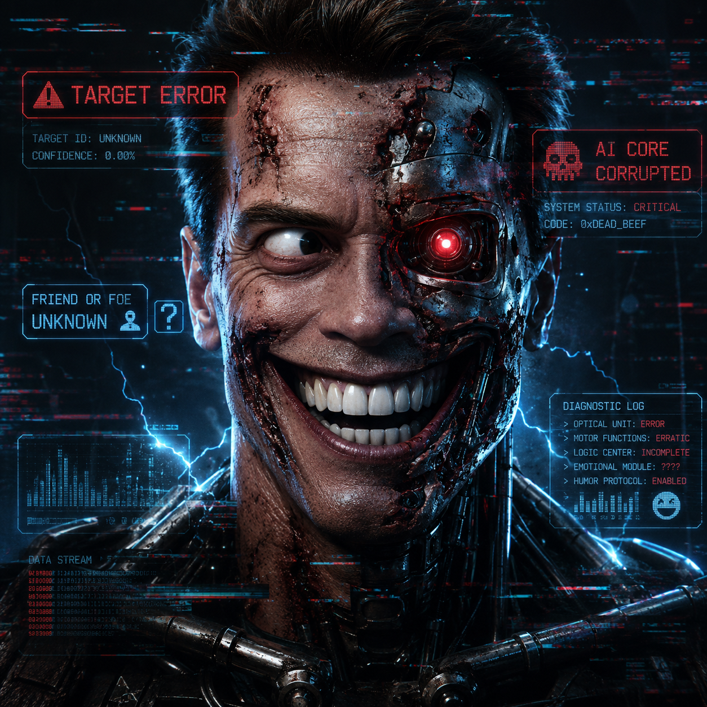

# Фагот-М2 — многофункциональный ПТРК-мод

**Игра:** Terminator: Dark Fate – Defiance · **Проверено на:** v1.08.1173 · **Статус:** публичная бета

[Русский](#ru) · [中文](#zh) · [English](#en)
> Языковой порядок, утверждённый автором: **Русский → 中文 → English** (третий блок в самом низу). Эта страница содержит все три языка сразу. Одноязычные копии: [README.ru.md](README.ru.md) · [README.zh.md](README.zh.md).

> Фанатский мод для одиночной игры. Не связан с Cats Who Play / Slitherine и не одобрен ими. TERMINATOR — товарный знак своих владельцев.
>
> Название заголовка — **Фагот-М2**, по прозвищу реальной советской ПТУР (семейство AT-4); по-китайски — 法戈特M2.

## Что добавляет мод

Мод **заменяет штатный Джавелин (Javelin) на многоцелевой ПТРК «Фагот-M2»** («Фагот» — реальное прозвище советской ПТУР). Добавляет три специальных типа боеприпасов плюс штатную ракету — итого 4 режима огня:

| Иконка | Режим | Эффект |
|---|---|---|
| 🚀 | Штатная ПТУР | обычная противотанковая ракета |
| 🔵 | **EMP** | ставит цель «на паузу» ~45 сек; команда не меняется |
| 🟡 | **Neural Breach** («Шизофреник») | захваченная цель становится союзным *автономным* юнитом (команда союзников) |
| 🟢 | **Cyber Hack** («Перехват») | захваченная цель переходит под *прямое управление игрока* (команда игрока) |

Обложка мода (`assets/cover_t800_schizo.png`):

## Как это работает (кратко)

- **Контент:** переопределения SpreadsheetML (`.xml`) добавляют строки снарядов и три профиля эффекта; режим диспетчеризуется по сигнатуре `life_time` (0.8 / 0.9 / 1.0), радиус эффекта единый — 30 м.
- **Рантайм:** пропатченный `logic.dll` игры выполняет смену команды при попадании и (в TRACE-сборках) пишет диагностические поля только захваченной цели. Глобальных AI-перехватов нет.
- **Защита:** установщик отказывается работать, если текущий `bin\logic.dll` не совпадает с проверенной базой (`SHA256 29EB…6044`); делает проверяемый бэкап и сверяет хэш после копирования. Откат тоже с проверкой хэша.

## Совместимость

- Сборка игры **1.08.1173** (тестировалась). Новые патчи могут менять содержимое PAK — перед установкой перепроверяйте пакет.
- **Рабочая бета:** баги есть, но мод работает. Быстрая самопроверка в «Схватке»: карта «Мосты», оппонент — Легион (Legion), выставьте юнитов с ПТРК и проверьте все 4 режима огня.
- Одиночная кампания, «Схватка», DLC (We Are Legion / Uprising); строки DLC генерируются установщиком из ваших установленных PAK.

## Установка (Windows)

1. Закройте игру.
2. Скопируйте папку мода в `…\Terminator Dark Fate - Defiance\mods\<папка мода>\`.
3. Запустите `INSTALL_FINAL.bat`.
4. В игре → меню **MODS** → включите этот пакет; отключите старые версии FagotM2.
5. Откат: запустите `RESTORE_REV1.9.1_STABLE.bat`.

## Известные проблемы

- Установщик прерывается с «hash mismatch» → текущий `logic.dll` не является проверенной базой. Сначала восстановите базу (см. `docs/RELEASE_FILES.md`).
- Тексты вида `[Resource 'fagot_…' not found]` → перезапустите установку, чтобы применилась русская локализация.

## Дорожная карта

- [ ] Починить «остаточный AI» у части захваченных юнитов (Takeover) — диагностическая сборка `REV1.9.4 TRACE V2` на тесте
- [ ] Балансировка (перезарядка, доступность) для «Схватки»
- [ ] Публичный ZIP и страница на Nexus Mods
- [ ] Опционально: иконки режимов для игрового UI (DDS)

## История версий

См. [CHANGELOG.md](CHANGELOG.md), техническую схему — [docs/ARCHITECTURE.md](docs/ARCHITECTURE.md).

## Лицензия

**CC BY-SA 4.0** (Creative Commons Attribution-ShareAlike 4.0 International).

- Разрешаю всем: делиться, менять и распространять можно свободно — в том числе в составе других модов и сборок — при условии **указания автора проекта Фагот-М2** и сохранения той же лицензии в производных.
- «Как есть», без гарантий. Только одиночная/офлайн игра.
- Полный текст лицензии: LICENSE или <https://creativecommons.org/licenses/by-sa/4.0/legalcode>

## Благодарности

- Идея, тесты, реверс-сессии: автор проекта Fagot-M2
- Ранние прототипы: совместная работа с LLM-ассистентами (сессии GPT) и текущая аудит-сессия GLM/OpenCode

---

## 法戈特M2 — 多用途反坦克导弹模组（中文版）

**游戏:** Terminator: Dark Fate – Defiance（终结者：黑暗命运——反抗军） · **已测试版本:** v1.08.1173 · **状态:** 公测（beta）

[Русский](#ru) · 中文 · [English](#en)

> 玩家自制模组，仅限单机使用。与 Cats Who Play / Slitherine 无关，也未经其认可。TERMINATOR 及相关商标归其权利人所有。
>
> 名称 **法戈特M2（Fagot-M2，Фагот）** 来自现实中苏联反坦克导弹系列的绰号。「法戈特」三字均为中性汉字，无歧义、无冒犯含义。

## 模组内容

本模组**将原版 Javelin（标枪）反坦克导弹发射器替换为多用途导弹套件 Fagot-M2**（「Фагот」是现实中苏联反坦克导弹的绰号），并新增三种特殊弹药，外加原版火箭——共四种射击模式：

| 图标 | 模式 | 效果 |
|---|---|---|
| 🚀 | 原版火箭 | 普通反坦克火箭 |
| 🔵 | **EMP（电磁脉冲）** | 使目标瘫痪约 45 秒；阵营不变 |
| 🟡 | **Neural Breach（「策划反叛」/ Schizo）** | 被击中的目标转为友军 *自主* 单位（友军黄色阵营） |
| 🟢 | **Cyber Hack（「接管」/ Takeover）** | 被击中的目标直接改由 *玩家操控*（玩家绿色阵营） |

## 工作原理（简述）

- **内容层：** 通过 SpreadsheetML（`.xml`）覆盖文件追加弹药行和三种效果配置；模式由 `life_time` 签名（0.8 / 0.9 / 1.0）区分，统一 30 米效果半径。
- **运行层：** 修改后的游戏 `logic.dll` 在弹体命中时执行阵营切换，并在 TRACE 版本中仅记录被接管目标的诊断字段。没有全局 AI 钩子。
- **安全闸门：** 安装脚本会校验当前 `bin\logic.dll` 的 SHA256，只有匹配已验证基线（`29EB…6044`）才安装；安装前备份、安装后复核，回滚脚本同样校验哈希。

## 兼容性

- 已在游戏版本 **1.08.1173** 上测试。新补丁可能改变 PAK 内容——使用前请重新校验包。
- **可玩的公测版：** 存在一些 Bug，但模组可用。快速自测（遭遇战）：选择「桥梁（Bridges）」地图，对手设为 Legion（军团），部署反坦克部队并依次验证 4 种模式。
- 支持单人战役、遭遇战（Skirmish）以及两个 DLC（We Are Legion / Uprising）；DLC 数据在安装时由已安装的 PAK 生成。

## 安装（Windows）

1. 关闭游戏。
2. 将模组文件夹复制到 `…\Terminator Dark Fate - Defiance\mods\<模组文件夹>\`。
3. 运行 `INSTALL_FINAL.bat`。
4. 游戏内 → **MODS** 菜单 → 只启用本模组，停用旧版 FagotM2。
5. 回滚：运行 `RESTORE_REV1.9.1_STABLE.bat`。

## 常见问题

- 安装器提示哈希不匹配 → 当前 `logic.dll` 不是已验证的基线。请先恢复基线（见 `docs/RELEASE_FILES.md`）。
- 出现 `[Resource 'fagot_…' not found]` → 重新运行安装器以应用俄语本地化覆盖。

## 路线图

- [ ] 修复部分被接管单位的「残留自主行动」（Takeover）——诊断版本 `REV1.9.4 TRACE V2` 正在测试
- [ ] 遭遇战平衡性调整（冷却、可用性）
- [ ] 发布公开 ZIP 与 Nexus Mods 页面
- [ ] 可选：游戏内 UI 图标（DDS）

## 版本历史与技术说明

见 [CHANGELOG.md](CHANGELOG.md) 与 [docs/ARCHITECTURE.md](docs/ARCHITECTURE.md)。

## 许可

**CC BY-SA 4.0**（署名-相同方式共享 4.0 国际）。

- 任何人都可以分享、修改与再分发——包括放进其他模组或合集——但必须**注明 Fagot-M2 项目原作者**，且衍生作品沿用相同许可。
- 按「现状」提供，不作任何担保。仅限单机/离线使用。
- 许可全文见 LICENSE 或 <https://creativecommons.org/licenses/by-sa/4.0/legalcode>

## 致谢

- 创意、测试与逆向工程：Fagot-M2 项目作者
- 早期原型：与 LLM 助手（GPT 会话）及 GLM/OpenCode 审计会话协作完成

---

## Fagot-M2 — Multirole ATGM Suite (English)

**Game:** Terminator: Dark Fate – Defiance · **Tested on:** v1.08.1173 · **Status:** public beta

[Русский](#ru) · [中文](#zh) · English

> Fan-made mod for offline/single-player use. Not affiliated with, or endorsed by, Cats Who Play or Slitherine Software. TERMINATOR and related marks belong to their respective owners.
>
> **Fagot-M2** (Фагот-М2) — the name follows the real-world Soviet ATGM family «Фагот» (AT-4 series, NATO-reported "Fagot"; the word also means "bassoon" — the musical instrument). Chinese-title rendering: 法戈特M2.

## What this mod adds

This mod **replaces the vanilla Javelin ATGM with the Fagot-M2 multirole ATGM suite** («Фагот» — real-world Soviet ATGM nickname). It adds three special ammunition types, plus the stock rocket — four selectable fire modes total:

| Icon | Mode | Effect |
|---|---|---|
| 🚀 | Stock ATGM | regular anti-tank rocket |
| 🔵 | **EMP** | suspends the target for ~45 s; no team change |
| 🟡 | **Neural Breach** («Schizo») | captured target becomes an allied *autonomous* unit (ally-colored team) |
| 🟢 | **Cyber Hack** («Takeover») | captured target comes under *direct player control* (player team) |

## How it works (short version)

- **Content layer:** SpreadsheetML (`.xml`) overrides add the ammo rows and three effect profiles; the launcher mode is dispatched by the `life_time` signature (0.8 / 0.9 / 1.0) with a shared 30 m effect radius.
- **Runtime layer:** a patched game `logic.dll` performs the team switch at projectile impact and (in TRACE builds) logs diagnostic fields of the captured unit only. No global AI hooks.
- **Safety gates:** the installer refuses to install unless the current `bin\logic.dll` matches the verified baseline (`SHA256 29EB…6044`); it creates a verified backup first and re-verifies after copy. One-command rollback is hash-verified too.

## Compatibility

- Game build **1.08.1173** (tested). Newer patches may change PAK contents — re-run the package audit before trusting it.
- **Working beta:** bugs exist, but the mod is functional. Quick check in Skirmish: pick the **Bridges** map, set the opponent to **Legion**, deploy your ATGM teams and test all four fire modes.
- Works in the single-player campaign, Skirmish, and the DLCs (We Are Legion / Uprising); DLC rows are generated from your installed PAKs at install time.

## Installation (Windows)

1. Close the game.
2. Copy the mod folder to `…\Terminator Dark Fate - Defiance\mods\<mod folder>\`.
3. Run `INSTALL_FINAL.bat`.
4. In-game → **MODS** menu → enable this package; disable any older FagotM2 versions.
5. Rollback: run `RESTORE_REV1.9.1_STABLE.bat`.

## Troubleshooting

- Installer aborts with hash mismatch → your `logic.dll` is not the verified baseline. Restore the baseline first (see `docs/RELEASE_FILES.md`).
- Locale strings show as `[Resource 'fagot_…' not found]` → re-run the installer so the Russian locale override applies.

## Roadmap

- [ ] Fix "residual AI" on some captured units (Takeover) — diagnostic build `REV1.9.4 TRACE V2` under testing
- [ ] Balance pass (cooldowns, availability) for Skirmish
- [ ] Public release ZIP + Nexus Mods page
- [ ] Optional: in-game UI icons (DDS)

## Changelog & status

See [CHANGELOG.md](CHANGELOG.md) and [docs](docs/ARCHITECTURE.md).

## License

**CC BY-SA 4.0** (Creative Commons Attribution-ShareAlike 4.0 International).

- You may share, modify and redistribute for any purpose — including other mods and mod packs — as long as you **credit the Fagot-M2 project author** (the original mod creator) and keep derivatives under the same license.
- Provided "as is", without warranty of any kind. Single-player/offline use only.
- Full legal text: core/LICENSE or <https://creativecommons.org/licenses/by-sa/4.0/legalcode>

## Credits

- Concept, testing, and reverse-engineering sessions: the Fagot-M2 project author
- Early prototyping: work with LLM assistants (GPT sessions) and the current GLM/OpenCode audit session
